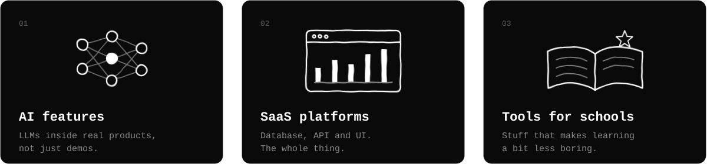

 

Hey, I'm Theo.

I build web apps and AI tools, mostly in TypeScript. Right now I'm working with the team at **NewCortex**, where I spend my days somewhere between the database, the API and the UI. I like taking an idea that only exists in a chat message and turning it into something people actually use.

### What I work on

### Stack

        
 
        

### Contributions

<picture>
  <source media="(prefers-color-scheme: dark)" srcset="https://raw.githubusercontent.com/camarinhatheo-ui/camarinhatheo-ui/output/github-snake-dark.svg" />
  <source media="(prefers-color-scheme: light)" srcset="https://raw.githubusercontent.com/camarinhatheo-ui/camarinhatheo-ui/output/github-snake.svg" />
  
</picture>

### Say hi

Got a project, an idea or a bug that's been haunting you? Send me an email.

 

Red Bull photo: <a href="https://commons.wikimedia.org/wiki/File:Red_Bull_Energy_Drink,_Dongguan,_China_1_May_2024.jpg">メイド理世 / Wikimedia Commons</a>, <a href="https://creativecommons.org/licenses/by-sa/4.0/">CC BY-SA 4.0</a>, cropped.
